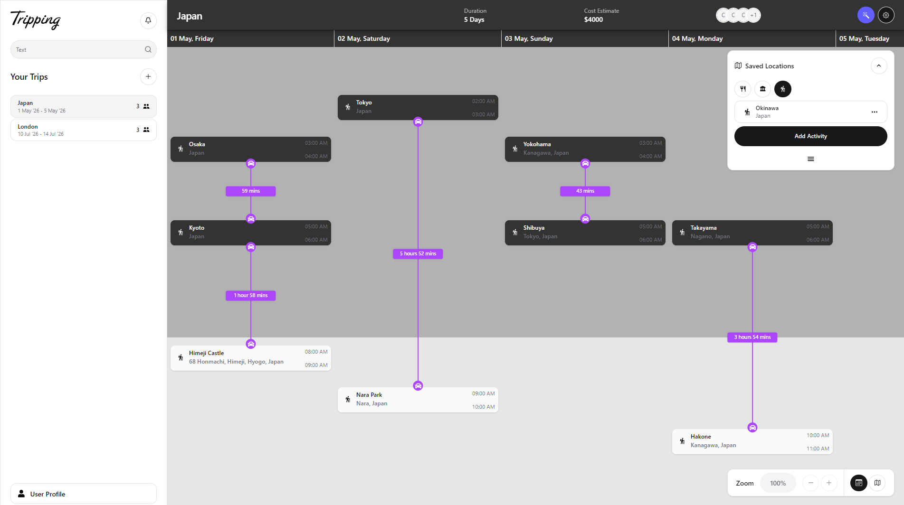
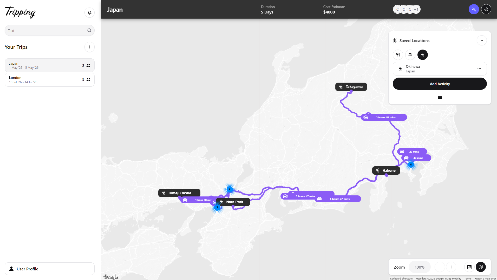

## Preview

  
  

# Tripping App

A modern and interactive **trip planning application** that helps users organize activities, manage timelines, and visualize routes on a map — all in a smooth drag-and-drop experience.

---

## Features

- **Drag & Drop Planning**
  - Move activities between timeline and activity panel
  - Smooth and interactive UI

- **Timeline Management**
  - Plan your day hour-by-hour
  - Automatic duration handling

- **Transport Integration**
  - Add transport between activities
  - Distance calculation between locations

- **Google Maps Integration**
  - Route visualization
  - Marker clustering
  - Zoom-based rendering

---

## Tech Stack

- **Frontend**
  - Next.js
  - TypeScript
  - Tailwind CSS

- **Libraries & Tools**
  - dnd-kit
  - Shadcn/Ui

- **Backend (Integration)**
  - firebase

- **Maps**
  - Google Maps API

---

## My Contribution

- Implemented complete **frontend UI and logic**
- Integrated **backend APIs (Firebase-based)**
- Built **drag-and-drop system using dnd-kit**
- Managed **state and optimized API calls**
- Implemented **Google Maps routes and clustering**

## Author

Built by **Kunal Kumar Soni**
